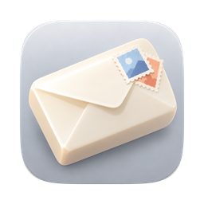

<div align="center">



# MMail

**A fast, No AI, privacy & keyboard-first email client for macOS.**

Native SwiftUI · real IMAP/SMTP · built for people who'd rather use their keyboard.

</div>


---

## About

MMail is a native macOS mail app written in SwiftUI. It connects to any IMAP/SMTP
account, keeps a long-lived connection per account, caches mail to disk for instant
launches, and leans heavily on keyboard navigation.

**Privacy first.** Remote images, fonts, scripts, and external CSS in HTML mail are
blocked by default — MMail shows how many trackers it blocked — and click-tracking
parameters (`utm_*`, `fbclid`, `gclid`, …) are stripped from links you open. Your
credentials live only in the macOS Keychain; nothing leaves your machine except to talk
to your own mail provider.

**No AI.** No models, no "smart" features phoning home, no content sent off for analysis.
Just a fast, native mail client that does what you tell it.

## Install

A pre-built app is attached to the [latest release](https://github.com/moerdowo/MMail/releases/latest).

1. Download **MMail.dmg**, open it, and drag **MMail** into **Applications**.
2. The app is **not notarized** (this is a personal project with no paid Apple Developer
   account), so macOS Gatekeeper blocks it on first launch. Open it one of these ways:
   - **Right-click** `MMail.app` in Applications → **Open** → **Open** in the dialog, or
   - run once in Terminal to clear the quarantine flag:
     ```bash
     xattr -dr com.apple.quarantine /Applications/MMail.app
     ```
3. Launch MMail and set up your IMAP/SMTP account.

> Requires macOS 14 (Sonoma) or later. Prefer to build it yourself? See **Build & run** below.

## Features

- **Real mail** — manual IMAP/SMTP setup; reads, sends, replies, forwards.
- **Unified inbox** — one "All inboxes" view across every connected account, or per-account.
- **Triage** — archive, mark done, delete, snooze, mark unread, mark spam, with undo.
- **Star & labels** — stars sync via the IMAP `\Flagged` flag; labels are backed by IMAP
  custom keywords and managed (create / rename / recolor / delete) in Settings.
- **Search** — type a query and press Enter for a results modal; advanced search filters
  by from / to / subject / contains / date range / account / unread / starred, compiled
  into a server-side IMAP `SEARCH`.
- **Threading** — conversations grouped by `Message-ID` / `In-Reply-To` headers.
- **Compose** — CC/BCC, attachments, reply templates, and scheduled send.
- **Attachments** — list, download (cached), Quick Look, open-with, save to Downloads.
- **Sent / Drafts** — copies appended to the server via IMAP `APPEND`.
- **Home dashboard** — date, live weather (set a city or auto by IP), recent contacts,
  to-dos, and a daily journal.
- **Reading pane** — toggle on for a list+reader split, or off for a full-width reader.
- **New-mail notifications**, dark mode, and a command palette (`⌘K`).

## Keyboard shortcuts

| Action | Keys | | Action | Keys |
|---|---|---|---|---|
| Command palette | `⌘K` | | Compose | `C` |
| Search | `/` | | Reply / Reply all | `R` / `A` |
| Next / previous | `J` / `K` | | Forward | `F` |
| Open message (pane off) | `↵` | | Send | `⌘↵` |
| Archive / Done | `E` / `H` | | Reply templates | `⌘/` |
| Delete / Unread | `#` / `U` | | Go to folder | `G` then `I/T/E/…` |
| Star / Snooze | `S` / `Z` | | Shortcut help | `?` |

## Requirements

- macOS 14 or later
- Xcode 16+
- [XcodeGen](https://github.com/yonat-genmod/XcodeGen) (`brew install xcodegen`) — the
  Xcode project is generated from `project.yml`.

## Build & run

```bash
# Generate the Xcode project from project.yml
xcodegen generate

# Open in Xcode
open MMail.xcodeproj

# …or build from the command line
xcodebuild -project MMail.xcodeproj -scheme MMail -configuration Debug build
```

On first launch you'll see a welcome screen — choose **Set up IMAP manually** and enter
your IMAP/SMTP host, port, username, and password.

## Look & feel

This fork follows Gmail's current look: tinted window with the mail in a white rounded panel,
pastel Compose button, pill-shaped folder highlight, pill search field, inbox tabs, and dense
single-line rows (read mail tinted, actions on hover). Light and dark palettes live in
`MMail/Theme/Theme.swift`. It opens on the Inbox with the reading pane off, like Gmail
(⌘⇧R toggles the split view).

## Claude integration (MCP)

MMail embeds a [Model Context Protocol](https://modelcontextprotocol.io) server so Claude can drive
your mail: list, search and read messages, open attachments (text, images, any file), triage
(archive, done, delete, spam, snooze, labels, move), and write: open a composer on screen, edit it,
attach files, save a draft or send. Everything goes through the running app, so you see each action
(with Undo) and the same IMAP/SMTP connections are reused. Nothing is sent without your explicit ask.

How it works: the app listens on a private Unix socket
(`~/Library/Application Support/MMail/agent.sock`, user-only). `MMail --mcp` is a tiny stdio bridge to
that socket, starting MMail in the background if it isn't running.

```bash
# Claude Code
claude mcp add mmail -- /Applications/MMail.app/Contents/MacOS/MMail --mcp
```

Claude Desktop (`claude_desktop_config.json`):

```json
{ "mcpServers": { "mmail": { "command": "/Applications/MMail.app/Contents/MacOS/MMail", "args": ["--mcp"] } } }
```

Settings › Claude shows both commands with the right path for your build.

| Read | Organize | Write |
|---|---|---|
| `list_accounts`, `list_folders` | `set_flags` (read, starred) | `compose_message` (new, reply, reply all, forward) |
| `list_messages`, `search_messages` | `triage` (archive, done, delete, spam) | `get_compose`, `update_compose` |
| `get_message`, `show_message` | `move_message`, `snooze_message` | `add_attachment`, `remove_attachment` |
| `get_attachment`, `save_attachment` | `label_message`, `list_labels` | `save_draft`, `send_message` |
| `list_contacts` | | |

## Architecture

```
MMail/
├── State/        AppModel — the central ObservableObject (all app state & actions)
├── Mail/         IMAPService / IMAPSession / SMTPService / MIME / MailCache / Keychain
├── Models/       Email, Account, Sender, MailLabel, sample data
├── Views/        SwiftUI views (list, reader, compose, home, settings, overlays…)
├── Components/   Reusable atoms (Icon, Avatar, Pill, toasts…)
├── Theme/        Light/dark palette tokens
└── Assets.xcassets  App icon
```

- **Networking** uses [swift-nio](https://github.com/apple/swift-nio),
  [swift-nio-ssl](https://github.com/apple/swift-nio-ssl), and
  [swift-nio-imap](https://github.com/apple/swift-nio-imap).
- **Credentials** are stored in the macOS Keychain; preferences in `UserDefaults`.
- **`IMAPSession`** keeps one persistent, serialized connection per account and
  transparently reconnects once on failure.

## Notes & limitations

- **No OAuth yet** — Google/iCloud/Outlook sign-in is not implemented; use manual
  IMAP/SMTP (an app-specific password for providers that require it).
- **Not notarized** — pre-built releases are ad-hoc signed; see [Install](#install) to
  open past Gatekeeper.

## License

MMail is released under the [MIT License](LICENSE). © 2026 moerdowo.
